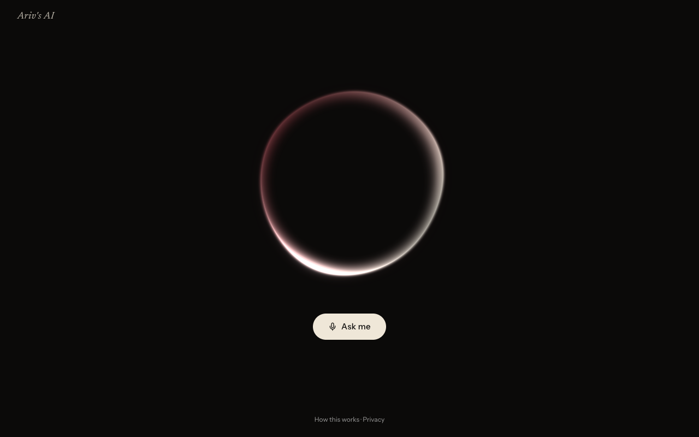
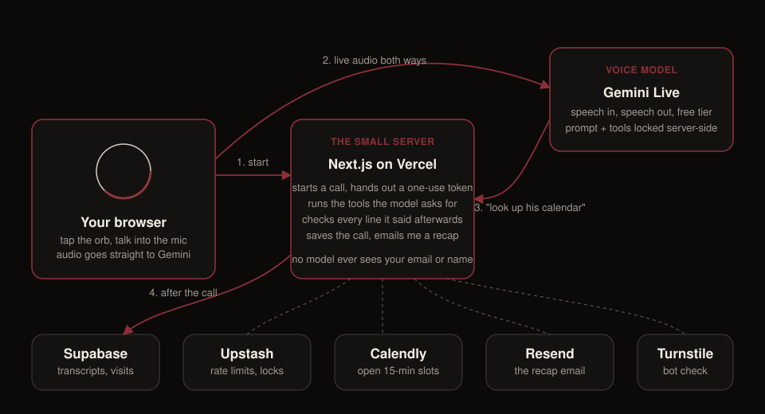

# Ariv's AI

**Talk to it:** [arivsai.app](https://www.arivsai.app)



## Why this exists

In the age of AI, nobody really has conversations to understand humans anymore. We send resumes, we send portfolios, we send links. I think a direct conversation says more about what a person can do, and whether they can get things done for you, than any of those. Face to face isn't always possible. So I built the next best thing.

This is a voice agent that knows my work. You open the page, press the button, and talk to it like you'd talk to a friend of mine who happens to know what I've built, where I work, and what I'm into. It'll tell you straight if I'd fit what you're hiring for, it won't make anything up, and if you want the real human it can pull up my calendar and find fifteen minutes.

It says it's an AI if you ask. It only says true things. And it runs on free tiers, so it costs me nothing to keep it up.

Go try it, then tell me what felt off. Feedback is the whole point.

## For the nerds

Here's the setup, kept short.



**The flow in four steps**

1. You press the button. The page asks a small server for permission to start a call. The server rate-limits, runs a bot check, and hands back a one-use token with the agent's instructions and tools already baked in. Nothing in your browser can change what the agent is allowed to say or do.
2. Your mic audio streams straight to Google's Gemini Live model, and its voice streams straight back. The server is not in the middle of the audio, which is why it feels quick.
3. When the model needs something it doesn't know, it asks the server: look up a fact, check the calendar, make a booking link. Links show up as cards in the chat so the agent never reads a URL out loud.
4. When the call ends, the server saves the transcript, runs a plain-code fact check over every line the agent said, and emails me a recap. Flagged lines land in that email so I can see where it went wrong.

**What it's made of**

| Piece | What it does |
|---|---|
| Next.js 16 + React 19 on Vercel | the page, the small server, the owner dashboard |
| Gemini Live (free tier) | the voice: speech in, speech out |
| One fact file | everything the agent may say about me lives in a single TypeScript file; the prompt inlines it |
| A regex verifier | checks each line for invented numbers, wrong titles, "I'm human", spoken URLs, confidential names |
| Supabase | transcripts, callers, first-party visit analytics |
| Upstash Redis | rate limits, per-call locks, small caches |
| Calendly | real open slots and tagged booking links |
| Resend | the recap email to me |
| Cloudflare Turnstile | keeps scripts from draining the free quota |
| Clerk | sign-in for the dashboard only; visitors never need an account |
| A WebGL orb (ogl) | the only thing on the landing page besides the button |

**Guardrails worth knowing**

- The agent runs in four modes (greeter, role researcher, scheduler, closer) that live in one prompt, so no rule disappears mid-call.
- No tool can email anyone or read another caller's data. Your name or email never passes through the model.
- Transcripts are assembled in your browser, so share links are opt-in and labelled as unverified, and they expire after 30 days.
- Visitors in the EEA, UK and Switzerland see links instead of voice (the free tier can't serve them) and stay anonymous in analytics. Do Not Track and Global Privacy Control turn tracking off entirely.
- Everything about data use is on the [privacy page](https://www.arivsai.app/privacy).

**Quality bar**

Around 260 unit and route tests, live red-team evals against the real voice model (prompt injection, false premises, invented numbers, "are you human"), a real-browser call test with a fake microphone, an accessibility scan, a bundle budget, and a nightly eval run. The checklists under `docs/checklists/` show exactly what was verified and what wasn't.

## Run it yourself

```bash
cd web && npm ci && cp .env.example .env.local   # fill in a Gemini key at minimum
npm run dev
```

Everything else is optional and documented in `web/.env.example`. The whole thing stays on free tiers.

## Say hi

If you build something like this for yourself, or you think the agent got something about me wrong, I'd like to hear it. Find me on [LinkedIn](https://www.linkedin.com/in/arivunidhi-anna-arivan/) or just [ask the AI](https://www.arivsai.app) to book a slot.
